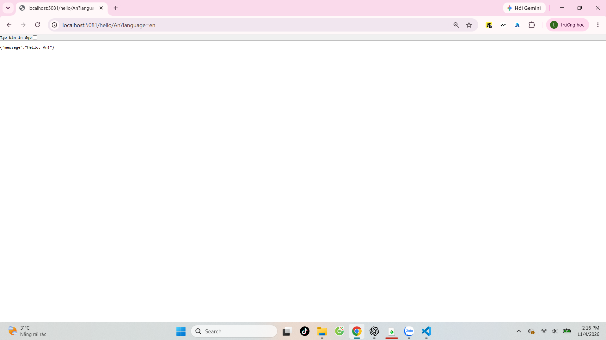
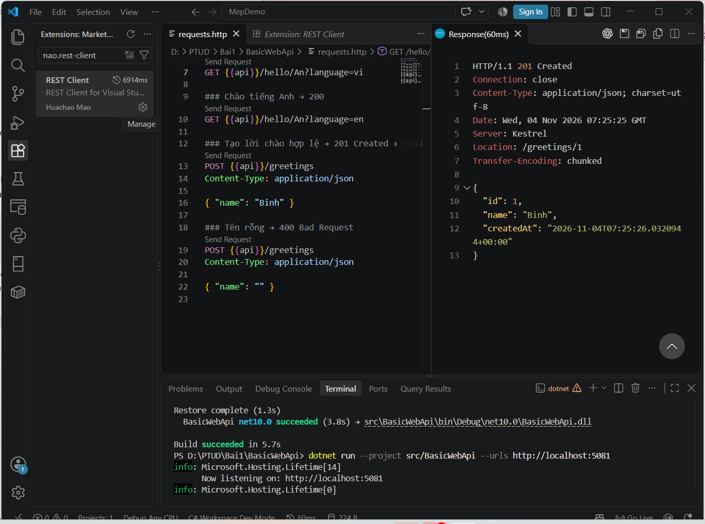
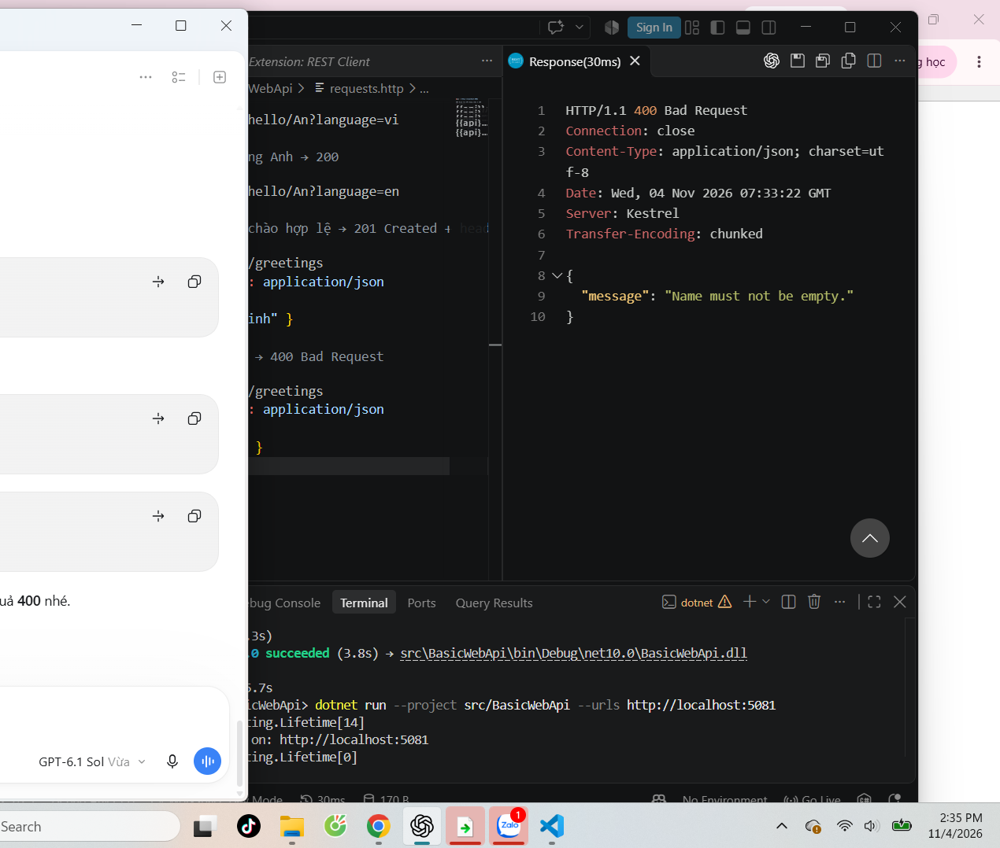

# Bài 1 – Tổng quan hệ thống và MEP

- Họ tên: Lưu Quang Lực
- MSSV: DTC245200349
- Lớp: CNTT K23E
- Ngày thực hành: 04/11/2026

## Nguồn kết quả và mức độ trợ giúp

Người học đã chạy MepDemo và BasicWebApi, cung cấp kết quả console và ảnh GET tiếng Anh, POST 201, POST 400 trong cuộc trò chuyện. Codex đã chuẩn bị mã EduSubmit, phần tiếng Nhật, chạy kiểm thử và thí nghiệm trên bản sao code mẫu. Không khai báo đây là code người học tự gõ. Người học cần đọc lại, tự chạy và giải thích được code trước khi nộp. Chưa thực hiện buổi debug tương tác với breakpoint; hướng dẫn ở mục 3.

## 1. Cài đặt

Đã kiểm tra máy có .NET SDK 10.0.401 và Git 2.55.0.windows.5. C# Dev Kit và REST Client đã được quan sát trong ảnh người học cung cấp. Build EduSubmit thành công: [log](evidence/build.txt). Tên thư mục có khoảng trắng vẫn build thành công; khi gõ đường dẫn đầy đủ cần đặt trong dấu nháy.

## 2. MepDemo

1. Request–response: gửi yêu cầu và chờ phản hồi; ví dụ SV001 nhận 8.5 điểm, SV002 quá thời gian chờ 1 giây. Timeout trong demo là tình huống chủ động minh họa.
2. One-way: sender gửi log rồi tiếp tục, không chờ kết quả nghiệp vụ ghi log.
3. Queue: mỗi bài nộp được một worker xử lý; các worker cạnh tranh lấy việc trong cùng hàng đợi. Trong lần chạy người học gửi, Worker-A xử lý sub-1, sub-4; Worker-B xử lý sub-2, sub-3. Cách phân chia có thể khác giữa các lần chạy.
4. Publish–subscribe: một sự kiện SubmissionGraded tới cả ba dịch vụ ScoreService, NotificationService và StatsService.
5. Streaming: client nhận liên tiếp received, processing 30%, processing 70%, graded: 8.5.

Queue dùng để chia việc giữa các worker; publish–subscribe dùng để phát cùng sự kiện cho nhiều bên có trách nhiệm khác nhau. Demo dùng các thành phần trong một tiến trình để mô phỏng, không phải broker hay hệ thống mạng thực.

[Kết quả chạy lại của Codex](evidence/MepDemo-output.txt).

## 3. BasicWebApi

- GET trả 200: lấy thông tin hoặc lời chào.
- POST tên Binh trả 201, có Location /greetings/1.
- POST tên rỗng trả 400 với Name must not be empty.
- Đã thêm language=ja trả Konnichiwa, An! trong bản mẫu hoàn thiện.

Trả lời câu hỏi:

1. builder.Services.AddSingleton phải đứng trước builder.Build để đăng ký GreetingService vào bộ chứa dịch vụ trước khi xây dựng ứng dụng.
2. name lấy từ route /hello/{name}; language lấy từ query string sau dấu ?.
3. POST hợp lệ tạo tài nguyên mới nên trả 201 Created, kèm Location chỉ tài nguyên được tạo. 200 biểu thị yêu cầu thành công nói chung.

Debug tương tác cần người học thực hiện thêm: mở đúng thư mục BasicWebApi trong VS Code, dừng API đang chạy, đặt breakpoint ở var greeting = service.Create(...), chọn Debug → Start New Instance trong Solution Explorer. Gửi POST, xem request.Name, dùng F10 bước tiếp, F5 tiếp tục và Shift+F5 dừng. Cổng thực tế khi debug có thể theo launch profile; sửa @api cho khớp.

### Ảnh kết quả người học đã cung cấp







## 4. MiniDistributedSystem

API và Client là hai tiến trình độc lập.

| Yêu cầu | Kết quả |
|---|---|
| GET /api/assignments | 200, mảng bài tập |
| POST /api/submissions | 201, mã GUID và trạng thái received |

Client không tham chiếu project API. Hai bên thống nhất qua HTTP, endpoint, method, mã trạng thái và cấu trúc JSON. Truyền URL từ tham số giúp đổi máy chủ hoặc cổng mà không sửa mã nguồn. Mỗi lần gửi POST hợp lệ sinh GUID mới.

[Kết quả API + Client mẫu](evidence/mini-client.txt).

## 5. Thí nghiệm lỗi

Các dự đoán dưới đây do Codex đặt trước khi thực hiện thí nghiệm trên bản sao MiniDistributedSystem. Cổng 15000/15050 dùng thay cho 5000/5050 để tránh ảnh hưởng API đang chạy trên máy; cơ chế tương đương. Sau mỗi thí nghiệm, mã nguồn mẫu được hoàn nguyên và build lại.

| # | Dự đoán của Codex | Thực tế | Đúng/Sai | Giải thích |
|---|---|---|---|---|
| a | Thêm bài tập 3, client tự in thêm mà không sửa code | Client in 3: Bai tap 3, nộp bài thành công | Đúng | Client đọc mảng JSON và duyệt mọi phần tử; hợp đồng không đổi |
| b | Tắt API, client không kết nối được | HttpRequestException, tiến trình client kết thúc lỗi | Đúng | Kết nối mạng phụ thuộc tiến trình đích, cổng và đường truyền. Gọi hàm nội bộ không có lỗi mạng này nhưng vẫn có thể phát sinh ngoại lệ khác |
| c | StudentCode rỗng bị API từ chối | HTTP 400; EnsureSuccessStatusCode ném HttpRequestException | Đúng | Hàm này ném ngoại lệ nếu mã không thuộc 200–299. Server phải tự kiểm tra vì mọi client đều có thể gửi dữ liệu không hợp lệ |
| d | API đổi cổng, client gọi cổng cũ sẽ lỗi | Cổng cũ kết nối thất bại; truyền URL mới thì thành công | Đúng | Đổi tham số sau --, không cần sửa code |

Log: [a](evidence/experiment-a.txt), [b](evidence/experiment-b.txt), [c](evidence/experiment-c.txt), [d](evidence/experiment-d.txt).

## 6. EduSubmit và phần mở rộng

Đã có solution EduSubmit.slnx với hai project không tham chiếu nhau. API kiểm tra dữ liệu, tạo GUID, trả 201 + Location và lưu lượt nộp trong bộ nhớ. GET /api/submissions/{id:guid} trả 200 nếu tồn tại, 404 nếu không. Client đọc lại lượt nộp ngay sau khi tạo.

```text
Client -- HTTP GET /api/assignments --> API -- 200 + JSON --> Client
Client -- HTTP POST /api/submissions --> API -- 201 + JSON + Location --> Client
Client -- HTTP GET /api/submissions/{id} --> API -- 200 + JSON --> Client
```

Tất cả là request–response. API dùng ConcurrentDictionary thay cho List được gợi ý trong đề để hỗ trợ truy cập đồng thời. Dữ liệu mất khi API khởi động lại. RepositoryUrl đang là URL ví dụ, chưa phải link repository thật.

Phần tham khảo: Codex đã đọc Program.cs của cả ba chương trình mẫu để chuẩn bị mã và giải thích. Người học chưa xác nhận tự viết lại mã.

[Client EduSubmit](evidence/edusubmit-client.txt) · [HTTP chi tiết](evidence/http-results.json) · [Trang xem kết quả](ket-qua-kiem-thu.html).

## 7. Khó khăn và cách giải quyết

- Mở file BasicWebApi trong workspace MepDemo khiến C# Dev Kit cảnh báo project chưa thuộc workspace: thêm project hoặc mở đúng thư mục solution.
- Không thấy Send Request: cài REST Client của Huachao Mao.
- GET /favicon.ico trả 404 vì dự án không có biểu tượng trang; không ảnh hưởng endpoint bài tập.
- Cổng bị chiếm: kiểm tra URL đang nghe; dùng cổng khác và đồng bộ URL cho client/requests.http.

## 8. Việc còn cần trước khi nộp

- Tự chạy lại, làm debug breakpoint và lưu ảnh thực tế của mình vào docs.
- Tạo repository GitHub; thay URL ví dụ trong client và requests.http bằng link thật.
- Commit phần bổ sung, chuyển tag bai1 tới commit cuối nếu có sửa, rồi đẩy main và tag lên repository.
- Nộp link lên LMS theo yêu cầu giảng viên. Chưa thực hiện thao tác nộp bài.
